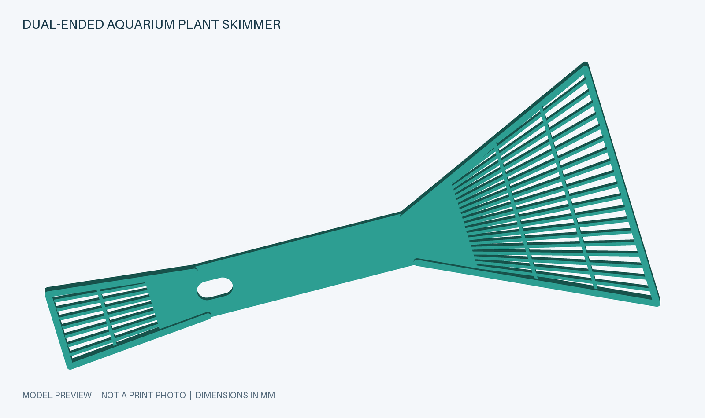

# Dual-Ended Aquarium Plant Skimmer

A customizable aquarium plant skimmer and beginner-friendly OpenSCAD example.

**Status:** compiled in OpenSCAD 2021.01; STL mesh preview inspected. Not yet test-printed or tested in an aquarium.

## Included files

- `aquarium_skimmer.scad`: editable source with learning comments.
- `aquarium_skimmer.stl`: exported default geometry for your slicer.
- `aquarium_skimmer.png`: preview illustration generated from the STL.
- `LICENSE`: GNU GPL version 3.
- `MAKERWORLD_DESCRIPTION.md`: ready-to-paste listing description.
- `scripts/render_preview.py`: optional preview generator (requires Python and Pillow).

## Design

Open `aquarium_skimmer.scad` in OpenSCAD. It builds a double-ended aquarium plant skimmer: a wide fan at one end and a narrower fan facing the other way for reaching confined areas. Both fans have a solid neck section and a raised edge merged flush with the perimeter. The dimensions are estimated; this is not an exact copy of the pictured model.

The narrow fan uses `small_head_length = 70` and `small_head_width = 40` (43.2 mm including the edge), with nine ribs and two braces. Edit the parameters under **Narrow fan at opposite end** to change it. `small_fan_enabled = false` restores the single-ended tool and handle hanging hole.

The tool has an **18 × 10 mm oval hanging hole in the handle**. For the double-ended tool, its narrow-fan-side end starts exactly at the narrow fan base and extends 18 mm into the handle toward the large fan. `hole_base_offset = 0` controls this starting point; increasing it moves the slot farther into the handle. Change `hole_length` and `hole_width` to resize it, or set `hole_enabled = false` to remove it. The hole is cut after joining both fans and the handle, so their overlapping material cannot block the opening.

Both fan bases match the 28 mm handle width, including their edge rails. `neck_width = handle_width - rim_width` accounts for the rails, and `small_neck_width = neck_width` keeps the two bases equal. Changing `handle_width` updates both bases. The double-ended handle stays rectangular at both connections.

The fan's narrow section nearest the handle is now solid up to the first cross-brace. Adjust `solid_neck_length` (default 25 mm from the neck), or set it to `0` to restore those narrow slots. Changing the brace positions may require adjusting this length too.

The default part is approximately **288.2 × 133.2 × 5.2 mm**, including a 2 mm raised lip along each fan's sides and wide front edge. The flat sieve is 3.2 mm thick. The lip and edge share `rim_width`, forming one continuous wall without a ledge at the lip's base. Adjust `lip_height`, or set `lip_height = 0` to disable the lips. `head_width` measures between the outer rail centrelines, so the rails add `rim_width` to the total width. The bottom sits at Z = 0. Check the overall size against your printer's build area.

## Try it

1. Open the SCAD file and press **F5** to preview (some Mac keyboards need Fn).
2. Change `head_width` from `130` to `110`, then preview again.
3. Change `rib_count` from `21` to `25`. More ribs produce smaller openings.
4. Change `brace_count` to `0` to see the fan without cross-braces.
5. Restore your preferred values, press **F6** to render, then use **File → Export → Export as STL**.

## Read the code from the bottom upward

At the bottom, `linear_extrude()` gives the handle its thickness. The reusable `fan_3d()` module builds each fan and lip. `mirror([1, 0, 0])` reverses the small fan along X; `translate()` moves it to the other end of the handle. Both heads reuse the same modules with different arguments, keeping the ribs and edge equally thick. The outer `union()` joins everything into one part.

| Construct | What it does here |
|---|---|
| `circle(d = ...)` | Draws a 2D circle |
| `translate([x, y])` | Moves a shape |
| `hull()` | Wraps two circles to make a rounded bar |
| `difference()` | Removes the hanging hole from the handle |
| `for (...)` | Repeats ribs or braces |
| `lerp(a, b, t)` | Calculates intermediate positions |
| `linear_extrude(height = ...)` | Gives the flat drawing a Z thickness |
| `mirror([1, 0, 0])` | Reverses the small fan along the X axis |

`[x, y]` is a 2D position. The handle extends along negative X; the fan extends along positive X. Y runs across the width. All ribs overlap the handle at the neck, and the braces intersect the ribs.

## Before printing

Render and inspect the model in OpenSCAD, then inspect the sliced layers, especially the thin ribs and narrow slots near the neck. The openings widen toward the tip; this design does not have a uniform mesh size. Measure your existing tool if you want a size match. Print with the broad flat face on the bed; the geometry is intended to need no supports. Check that the part fits your printer's build area.

Validated with OpenSCAD 2021.01: the source compiled and exported successfully to `aquarium_skimmer.stl`. The included preview was generated from that STL using `scripts/render_preview.py`, avoiding the local OpenGL preview-export issue. The model has not been test-printed or tested in an aquarium.

## Contributing

Feedback, bug reports, dimension improvements, and pull requests are welcome. Include the parameter values and OpenSCAD version when reporting a geometry issue. If you test-print the tool, share your printer, filament, nozzle size, layer height, and a photo of the result. Keep the generated STL consistent with any changes to the default SCAD parameters.

The design was developed with AI assistance from visual references and iteratively adjusted. Reference photographs are not included in this repository.

## License

This project is licensed under **GNU GPL version 3 only** (`GPL-3.0-only`). See [LICENSE](LICENSE) for the full terms. Contributions should use the same license.
